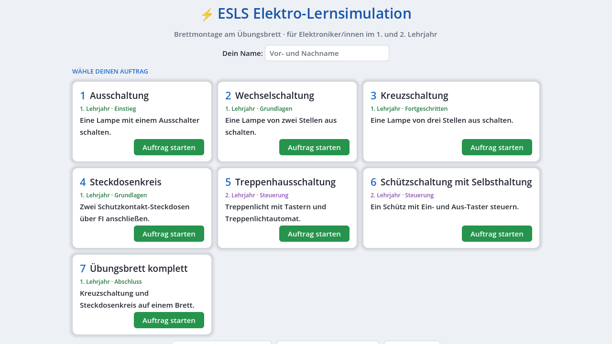
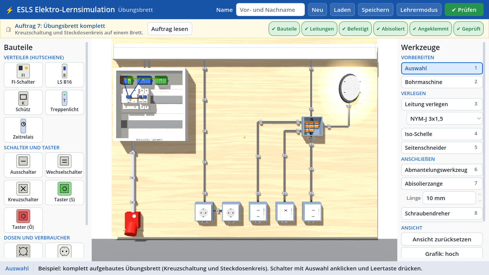
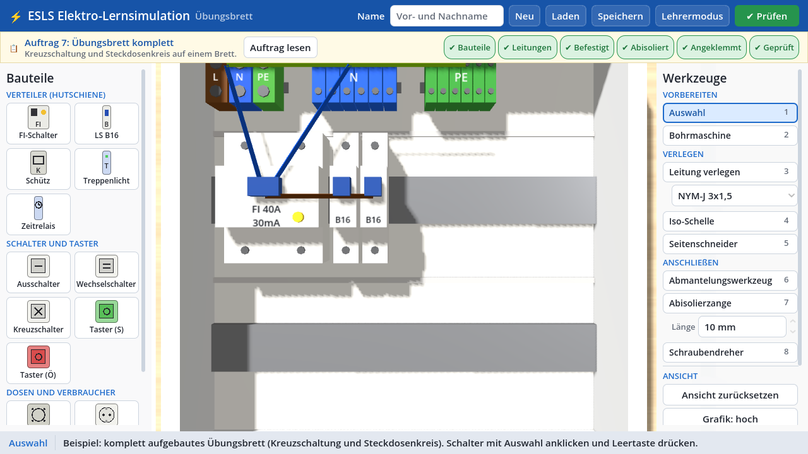
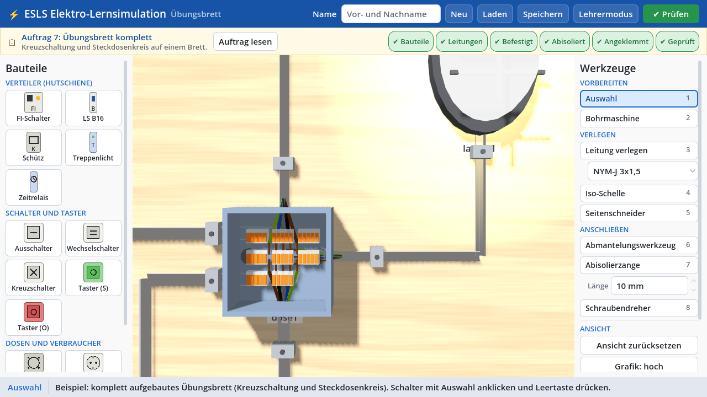
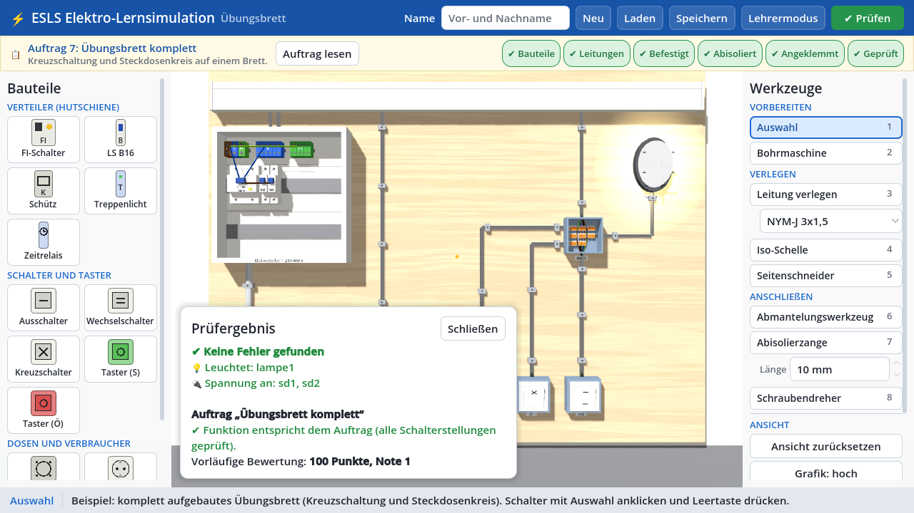
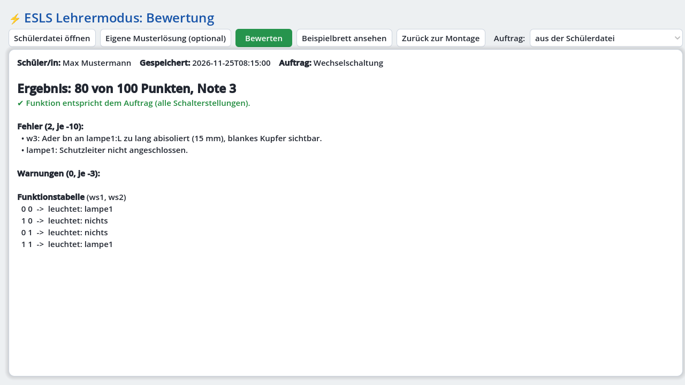

# ESLS – Elektro-Lernsimulation Brettmontage

Lernprogramm für Elektroniker-Azubis (1./2. Lehrjahr): Montage am Übungsbrett mit NYM-Leitungen,
Bohrungen, Iso-Schellen, Abmanteln/Abisolieren, Anklemmen in der Nahansicht und Prüfung
mit auslösendem LS/FI. Godot 4.7, Kompatibilitäts-Renderer (läuft auf schwachen Schul-PCs).

## Starten
Godot 4.7 öffnen → Projekt importieren → `project.godot` → **F5** (Hauptszene `montage.tscn`).

## Startbildschirm und Aufträge

Name eintragen und einen **Auftrag** wählen. Jeder Auftrag hat Auftragstext, benötigte Bauteile,
Lernziele und Tipps („Auftrag lesen“):

| # | Auftrag | Lehrjahr |
|---|---|---|
| 1 | Ausschaltung | 1 |
| 2 | Wechselschaltung | 1 |
| 3 | Kreuzschaltung | 1 |
| 4 | Steckdosenkreis (über FI) | 1 |
| 5 | Treppenhausschaltung (Taster + Treppenlichtautomat) | 2 |
| 6 | Schützschaltung mit Selbsthaltung | 2 |
| 7 | Übungsbrett komplett (Kreuzschaltung + Steckdosenkreis) | 1, Abschluss |

Oben läuft das **Arbeitsblatt** mit: Auftrag und die Arbeitsschritte *Bauteile → Leitungen → Befestigt →
Abisoliert → Angeklemmt → Geprüft*, die sich beim Arbeiten automatisch abhaken.

## Das Übungsbrett

Wie das Brett in der Werkstatt: Multiplexplatte, **Kabelkanal** oben, **Kleinverteiler** oben links
mit Hutschienen, Hauptklemme (L/N/PE), blauen N- und grünen PE-Klemmen, **CEE-Einspeisung** unten links,
Geräte im AP-Gehäuse unten, Abzweigdose mit Wago-Klemmen und ovale Feuchtraumleuchte rechts.
Beim Prüfen leuchtet die Leuchte, Wippen zeigen die Schalterstellung, ein ausgelöster LS/FI kippt den Hebel nach unten und wird rot.

## Ablauf einer Montage
1. **Bohrmaschine**: unter jedes Bauteil 2 Bohrungen, unter jede Schelle 1
2. **Bauteil setzen**: Kachel links wählen, aufs Brett klicken. FI, LS, Schütz und Relais rasten auf der **Hutschiene** im Verteiler ein (ohne Bohrung)
3. **Leitung verlegen**: Leitungstyp wählen, Start-Bauteil → Eckpunkte → Ziel-Bauteil. Über den Kabelkanal führen spart Schellen
4. **Iso-Schelle**: auf die Leitung über einer Bohrung klicken. Max. 25 cm Abstand und max. 10 cm vor dem Gerät, gemessen **entlang der Leitung**. Im Kabelkanal und im Verteiler sind keine Schellen nötig
5. **Abmantelungswerkzeug**, dann **Abisolierzange** (richtig sind 8–12 mm): Bauteil anklicken
6. **Schraubendreher**: Bauteil anklicken → Nahansicht → Ader links, Klemme rechts
   - Verteiler: Brücken mit H07V-K legen (zwei Klemmen nacheinander), N- und PE-Klemmen nutzen
   - Abzweigdose: Verbindungsklemmen einsetzen
7. **✔ Prüfen** (Taste P): Fehler, Warnungen und **Selbstkontrolle gegen den Auftrag** mit vorläufiger Note.
   Schalter mit **Auswahl** anklicken und **Leertaste** drücken. Treppenlicht geht nach 30 s wieder aus
8. **Speichern** (`.esim`) – die Datei enthält Name und Auftrag

## Lehrermodus

Schülerdatei öffnen → automatische Bewertung gegen den Auftrag aus der Datei (eingebaute Musterlösung):
Punkte, Note, Fehler, fehlende Bauteile/Anforderungen (z. B. Steckdose nicht über FI), Funktionstabelle.
Eine eigene Musterlösung ist optional. „Beispielbrett ansehen“ zeigt das fertig aufgebaute Übungsbrett.

## Tests (Szene öffnen, F6)
- `sim_test.tscn` – Prüflogik: LS/FI, PE, Farben, doppelt verwendete Adern, Befestigung über Kanal/Verteiler,
  Schütz, Kreuz-/Wechselschaltung, Treppenlicht, alle Aufträge mit 100 Punkten, Bewertung, Speichern
- `montage_test.tscn` – Montage-Werkzeuge, Ausschaltung über die Nahansicht und das **komplette Übungsbrett
  ohne einen einzigen Fehler oder Warnung**
- `perf_test.tscn` – Performancetest mit dem fertigen Übungsbrett (FPS, Zeichenaufrufe; Taste G = Grafik hoch/niedrig).
  Automatisch: `Godot.exe --path . perf_test.tscn -- --auto`

Ohne Fenster: `godot --headless sim_test.tscn --quit-after 5` (ebenso `montage_test.tscn`).
Screenshots: `godot --path . -s tools/screenshot.gd -- res://montage.tscn bild.png musterbrett_zeigen`

## Windows-Version bauen
Einmalig im Editor: *Editor → Exportvorlagen verwalten → Herunterladen*. Dann `build_windows.bat`
ausführen → `build\ESLS.exe` (eine Datei, ohne Installation).

Siehe auch [ROADMAP.md](ROADMAP.md) und [ENTSCHEIDUNGEN.md](ENTSCHEIDUNGEN.md).
